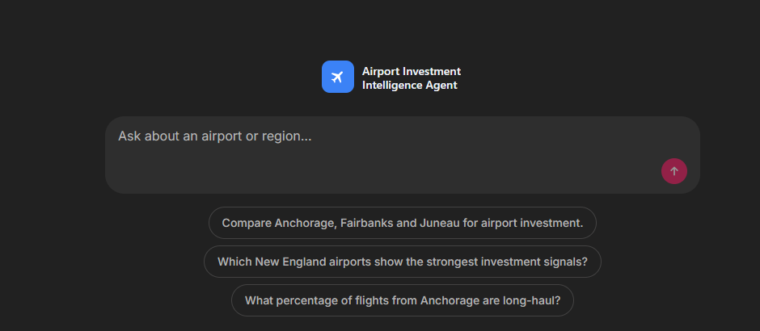
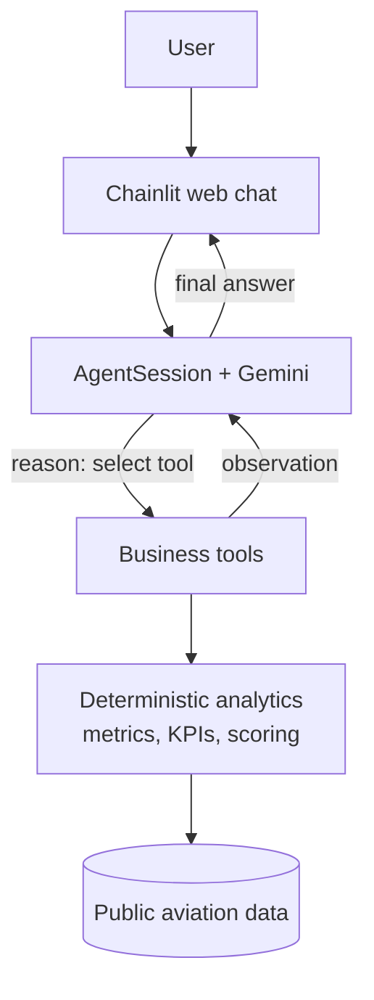
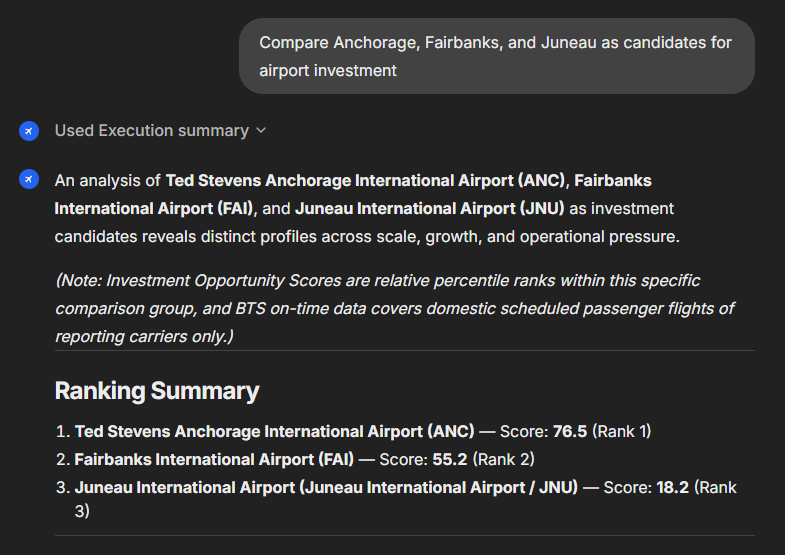

# Airport Investment Intelligence Agent

A conversational AI agent for airport investment analysis. It evaluates U.S. airports as candidates
for terminal renovation or expansion by combining public aviation data, deterministic analytics and
LLM-driven tool orchestration, and answers with evidence, relative rankings and stated data limitations.

🎥 **Demo:** [Watch the Airport Investment Intelligence Agent in action]((https://postbguacil-my.sharepoint.com/personal/ayelethc_post_bgu_ac_il/_layouts/15/stream.aspx?id=%2Fpersonal%2Fayelethc_post_bgu_ac_il%2FDocuments%2FAirport+Investment+Intelligence+Agent%2FAirport_Investment_Intelligence_Agent_Demo.mp4&ga=1&referrer=StreamWebApp.Web&referrerScenario=AddressBarCopied.view.f925e5f7-fdf3-4f8d-931d-e92be333ae1b))



## What it does

This is not a chatbot wrapped around an API. The Agent interprets a request, resolves or discovers
the airports, decides which analysis is needed, calls tools, observes the results and keeps
reasoning until it can answer, including follow-up questions.

Example questions:

- *Which airports in New England show the strongest investment signals?*
- *Compare Anchorage, Fairbanks, and Juneau for airport investment.*
- *What percentage of flights from Anchorage are long-haul?*

## How it works

**The LLM decides what and when; deterministic code defines how.**



The loop is iterative: **reason → tool → observation → reason → … → answer**.

| The LLM (Gemini) handles | Deterministic Python handles |
|---|---|
| Natural-language understanding | Data retrieval |
| Tool selection and multi-step orchestration | Metrics and KPI calculation |
| Follow-up questions | Normalization, scoring and ranking |
| Final synthesis and explanation | Business rules and guardrails |

The Agent is built directly on the Google Gemini SDK, so function calling, tool execution,
conversation state and Agent budgets are explicit code rather than hidden in a framework.

## Agent design

Gemini sees four business tools:

| Tool | Purpose |
|---|---|
| `resolve_airports` | Resolve airport names or cities (e.g. "John Wayne Airport in Santa Ana") to canonical airport codes |
| `discover_airports` | Find candidate airports in a country or set of states, with commercial-activity evidence |
| `analyze_airport` | Detailed analysis of one airport |
| `compare_airports` | Compare and rank a group of airports with relative Investment Scores |

- **Deterministic entity resolution.** Users refer to airports naturally; references are resolved
  against OurAirports data instead of trusting the LLM to remember airport codes. Ambiguous
  references are flagged so the Agent asks rather than guesses.
- **Conversation state.** Recent turns stay in context and older turns are retrieved on demand, so
  follow-ups work and evidence already gathered is reused instead of calling tools again.

A real multi-airport answer, showing the tool steps, relative Investment Scores, ranking and stated
data limitations:



## Analytics & data

Airports are scored on three KPI families:

- **Demand Growth**: post-COVID passenger CAGR.
- **Operational Pressure**: scheduled peak movements per runway, peak spacing, delay rates.
- **Scale & Connectivity**: passenger volume, departures, destinations, long-haul flights.

The **Investment Score** is a weighted combination of percentile ranks *within the current
comparison group*: it describes an airport's position among the airports compared together and is
not comparable across groups. **Capacity Pressure** is reported separately as a proxy. Airports with
insufficient data are reported as not scored.

Data sources:

- **OurAirports**: airport reference data, names, cities, coordinates, runways.
- **BTS T-100**: monthly passenger traffic by airport.
- **BTS On-Time Performance**: individual domestic flights, schedules, delays, distances.
- **OpenSky Network** (optional): client for source validation; not used by the Agent's analytics.

Definitions and rationale: [`docs/KPIS.md`](docs/KPIS.md), [`docs/METRICS.md`](docs/METRICS.md),
[`docs/DATA_SOURCES.md`](docs/DATA_SOURCES.md), [`docs/AGENT_TOOLS.md`](docs/AGENT_TOOLS.md).

## Engineering highlights

- Tool-using Agent loop written directly on the Gemini SDK, with per-turn budgets.
- Deterministic analytics behind four LLM-visible business tools.
- Natural-language airport entity resolution.
- Multi-turn conversation memory with on-demand retrieval of earlier turns.
- Per-turn execution tracing of model and tool calls.
- Behavioral evaluation with resumable runs and contract fingerprinting, so incompatible Agent
  versions cannot be mixed.
- Centralized [`config.py`](config.py) and a Chainlit web interface.
- 577 passing offline tests.

The production model is `gemini-3.5-flash-lite`, chosen in V1 for responsive interactive use.

## Run locally

Requires Python 3.10–3.13 (developed on 3.12) and a Gemini API key.

```bash
git clone <repository-url>
cd <repository-folder>
python -m venv .venv
```

Windows:

```bat
.venv\Scripts\activate
pip install -r requirements.txt
copy .env.example .env
```

macOS / Linux:

```bash
source .venv/bin/activate
pip install -r requirements.txt
cp .env.example .env
```

Set `GEMINI_API_KEY` in `.env` (OpenSky variables are optional), then start the chat at
http://localhost:8000:

```bat
.venv\Scripts\chainlit run chat_app.py
```

```bash
.venv/bin/chainlit run chat_app.py      # macOS / Linux
```

Run the offline tests with `python -m unittest discover -s tests`. Tunable settings are in
`config.py`; secrets stay in `.env`.

## Limitations

- BTS On-Time covers domestic scheduled passenger flights of reporting carriers, not all airport
  operations; international, cargo, charter or non-reporting activity may be missing from the
  metrics based on it.
- Terminal capacity, gate utilization, passenger crowding and physical infrastructure condition are
  not measured.
- Capacity Pressure is a proxy built from other signals.
- Investment Scores are relative analytical scores for a comparison group, not forecasts of
  financial return.
